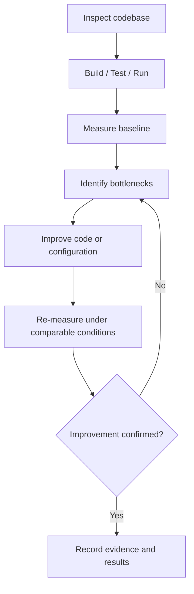
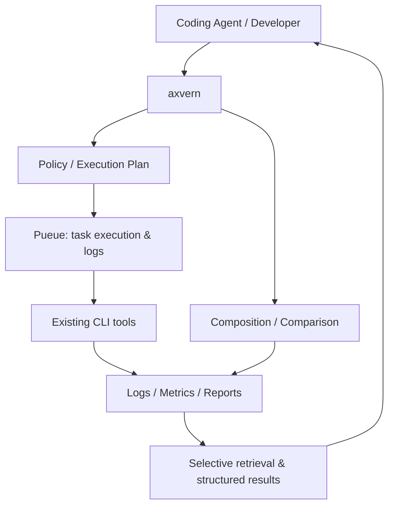
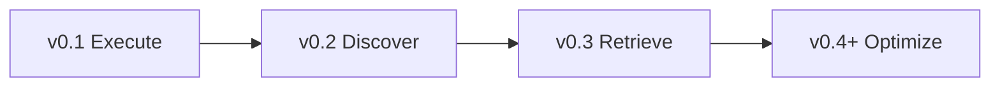

# axvern

**Measure. Understand. Optimize. Verify.**

**axvern** は、Coding Agentと開発者が、コードベースとプログラムの性能を根拠に基づいて改善するための **Rust製・開発最適化ハーネス** を目指すプロジェクトです。

Pueueによる非同期実行、Rust製を中心とした既存CLIの組み合わせ、実行結果の選択的取得を土台に、**調査 → 計測 → ボトルネック特定 → 改善 → 再計測** のサイクルを支援します。

> [!IMPORTANT]
> **設計・開発準備段階です。** 以下は構想・実装予定のコマンド仕様です。インストール可能な製品や動作確認済み機能を示すものではありません。性能改善の自動保証や、Agentによる無条件のコード変更は行いません。

## Why axvern?

Coding Agentはコードを生成できます。しかし、コードが動くことと、効率的に動くことは別問題です。

- ビルドが遅い場合、その原因がコンパイル、依存関係、リンク、キャッシュのどこにあるのか分かりにくい。
- プログラムが遅い場合、印象だけでは改善すべき箇所を特定できない。
- ビルド・テスト・計測のログが長く、Agentのコンテキストを圧迫する。
- 改善前後を同じ条件で計測しないと、性能が本当に改善したか判断できない。
- 優れたCLIが存在しても、Agentがツールごとのオプションや出力形式を都度扱う必要がある。

axvernは、**既存の開発・計測ツールを組み合わせ、Agentが解釈しやすい結果と再現可能な比較を提供する**ことを目標とします。

## Optimization loop



最適化は、**正しさを維持しながら、再現性のある計測結果に基づいて判断する**ことを前提にします。計測条件、比較対象、実行環境、実行IDを記録し、性能向上と引き換えの不具合を避けるためテスト結果も追跡します。

## Planned capabilities

### 1. Background command execution（v0.1）

[Pueue](https://github.com/Nukesor/pueue) をバックグラウンド実行基盤として利用します。v0.1では実行IDから状態を照会し、基本的なログ参照はPueueに委譲します。高度な部分抽出はv0.3で追加します。

<!-- 以下は全フェーズを含む予定コマンド例です。 -->
```bash
axvern run -- cargo test
axvern status <execution-id>
axvern wait <execution-id>

# v0.3で追加予定（v0.1では未提供）
axvern query <execution-id> --errors
axvern query <execution-id> --match "error"
axvern recall <execution-id>
```

`query` と `recall` はコマンドを再実行しません。ログ保持期間やPueue側の削除に制約があり、stdoutとstderrの完全分離復元は保証しません。

### 2. Codebase inspection（v0.2）

`eza`、`fd`、`rg`、`bat`、`ast-grep`、`tokei` を組み合わせ、コードベースの規模・構造・言語構成・検索対象を把握します。

```bash
axvern fs list ./src
axvern fs find --glob '*.rs' ./src
axvern fs search 'TODO' ./src
axvern fs read ./src/main.rs --from-line 1 --lines 80  # v0.2
axvern code search --pattern 'fn $NAME($$$ARGS) { $$$BODY }' ./src  # v0.2
axvern fs analyze . --max-depth 3 --format json  # v0.2
axvern code stats .                            # v0.2
```

`fs analyze` は、`eza`（構造）+ `fd`（ファイル・設定ファイル探索）+ `tokei`（コード統計）を統合する機能です。構造の検出結果と設計上の推定は明確に区別します。

### 3. Build and runtime measurement（v0.4以降の構想）

ビルド・実行を同じ条件で測定し、結果を比較するためのインターフェースを検討します。

```bash
# 以下は将来の構想。未確定のCLI仕様
axvern measure build -- cargo build --release
axvern measure run -- ./target/release/my-app
axvern benchmark --warmup 3 --runs 10 -- ./target/release/my-app
axvern compare <baseline-id> <candidate-id>
```

主な候補は [`hyperfine`](https://github.com/sharkdp/hyperfine)（反復計測・統計・JSON出力）、OS標準の計測機能、ビルドツール自身が提供するタイミング情報です。単発の実行時間と、統計的なベンチマーク結果は区別します。

### 4. Bottleneck investigation（v0.4以降の構想）

プロファイリング等の既存ツールを利用して、遅延が生じる箇所の調査を支援します。

- [`samply`](https://github.com/mstange/samply)：CPUプロファイル取得の候補。
- [`flamegraph`](https://github.com/flamegraph-rs/flamegraph)：プロファイルをフレームグラフとして表示する候補。
- [`hyperfine`](https://github.com/sharkdp/hyperfine)：改善前後の処理時間比較。
- `cargo` / `pnpm` / `moonrepo` 等：既存のビルドタスク、依存関係、実行メタデータの取得元。

プロファイラのOS対応、権限、計測オーバーヘッド、成果物形式は事前検証が必要です。Rustで書かれたCLIだけに限定すると必要な計測手段を失う場合があるため、**Rust製CLIを優先しつつ、用途に応じて非Rust製の既存ツールも採用**します。

### 5. Additional utilities（v0.2の候補・将来機能）

| Planned command | Existing CLI | Role |
| --- | --- | --- |
| `axvern code diff` | `git diff` + `delta` | 変更差分の把握 |
| `axvern system disk-usage` | `dust` | 大きなディレクトリの特定 |
| `axvern system processes` | `procs` | プロセス調査 |
| `axvern text replace` | `sd` | テキスト置換（追加候補・変更操作） |

## Design principle: Compose, don't reinvent



- **Pueue** は実行キュー、状態、ログ保持を担当。
- **既存CLI** は探索、解析、ビルド、計測、プロファイリングを担当。
- **axvern** は引数の検証、Policy、ツール選択、複数結果の統合、部分取得、比較レポートの整形を担当。
- **Coding Agent** は得られた証拠から変更案を検討し、テストと再計測で検証します。

コマンドの自動置換は既定で無効です。`find` / `fd` など、構文や挙動が異なるツールを無条件に変換しません。

## Roadmap

| Phase | Target | What axvern delivers |
| --- | --- | --- |
| **1 · Execute** | **v0.1** | Background commands with Pueue, task status, wait, history, basic execution guard |
| **2 · Discover** | **v0.2** | Smart codebase commands composed from eza, fd, ripgrep, bat, tokei, ast-grep |
| **3 · Retrieve** | **v0.3** | Temporary result storage, log query, selective extraction and recall without rerunning |
| **4 · Optimize** | **v0.4+** | Benchmarking, baseline comparison, performance regression and bottleneck investigation |



**Phase 1では`query`/`recall`を提供しない。Phase 2では高度なログ検索を前提にせず、既存CLIの結果を取得・表示する。** バージョンは実装予定であり、リリース済みを意味しない。詳しくは[Milestones](https://github.com/UtakataKyosui/axvern/milestones)を参照。

## Safety and measurement limitations

- コマンド実行ポリシーはOSレベルのサンドボックスではありません。Pueueへの安全な引数受け渡しは事前検証が必要です。
- 計測結果は実行環境、入力、キャッシュ、CPU負荷、ウォームアップなどの影響を受けます。異なる条件の計測値をそのまま改善率として扱いません。
- ベンチマークは複数回コマンドを実行します。副作用を持つ処理には明示的な許可と隔離が必要です。
- ログ・計測成果物には秘密情報が含まれ得るため、アクセス権・保存期間・機密情報の扱いを設計します。
- axvernは最適化の効果を保証しません。改善の判定には正しさの検証と比較可能な計測データが必要です。
- `--dry-run`、独自プロセスマネージャー、LLMによる自動変更、Docker必須化は初期スコープ外です。

## Requirements & documentation

要件定義・設計・受入条件・未決事項はGitHub Issueを正本として管理しています。
既存の設計文書の本文もIssueへ移管しました。

- [設計文書の移管先](https://github.com/UtakataKyosui/axvern/issues/5)
- [サブコマンドの要件定義Issue](https://github.com/UtakataKyosui/axvern/issues?q=is%3Aissue%20label%3Adesign)
- [共通CLI契約・結果取得・設定](https://github.com/UtakataKyosui/axvern/issues/34)
- [クレート選定の提案](https://github.com/UtakataKyosui/axvern/issues/7)

`sites`は実装・検証済み機能の公開ドキュメントを作成するプロジェクトです。

## Workspace development

Rustは `rust-toolchain.toml` の **1.98.0** に固定し、workspaceのMSRVも1.98とします。
更新はtoolchainとMSRVを同時に変更し、workspace全体を検証します。

| 配置 | package / 責務 |
| --- | --- |
| `logics/models` | `axvern-models`: 共有型・Trait。runtime・CLI・具体的I/Oに依存しない |
| `logics/core` | `axvern-core`: ユースケース・Policy・Adapter。modelsに依存 |
| `logics/tests` | `axvern-tests`: 非公開のロジック・契約・統合テスト。core/modelsを検証 |
| `tools/cli` | `axvern-cli`: 引数・配線・表示・終了コード。公開binary名は `axvern` |
| `qualities` | workspace品質タスクの設定 |
| `sites/axvern-document-site` | 公開ドキュメントプロジェクト |

Cargoがpackageと依存、Moonが横断実行を管理します。Moon **2.6.2**、Node **24**、pnpm **12** を検証済みです。
Moonはsystem toolchainを使い、Rust/Nodeを自動更新しません。Moonが未導入なら `pnpm dlx @moonrepo/cli@2.6.2` を `moon` の代わりに使えます。

```bash
# サイトの既存lockfileから依存を復元
pnpm --dir sites/axvern-document-site install --frozen-lockfile
moon projects
moon run qualities:verify

# 個別実行
moon run qualities:fmt qualities:clippy qualities:test qualities:build
moon run site:check site:build
cargo tree --locked -e features
```

Moonのcheckはファイルを書き換えません。公開コマンドの機能実装・Pueue Spike・CIは後続Issueの対象です。
承認済みの設計判断と検証報告はIssue #5〜#7に反映済みです。[.github/issue-updates](.github/issue-updates/) は反映内容の控えで、正本はGitHub Issueです。

## Development status

現在は**設計段階**です。インストール手順、対応OS、依存ツールの必要バージョン、配布方式、ライセンスは決定・検証後に追記します。

**Don't reinvent the command. Compose it. Measure the result.**
