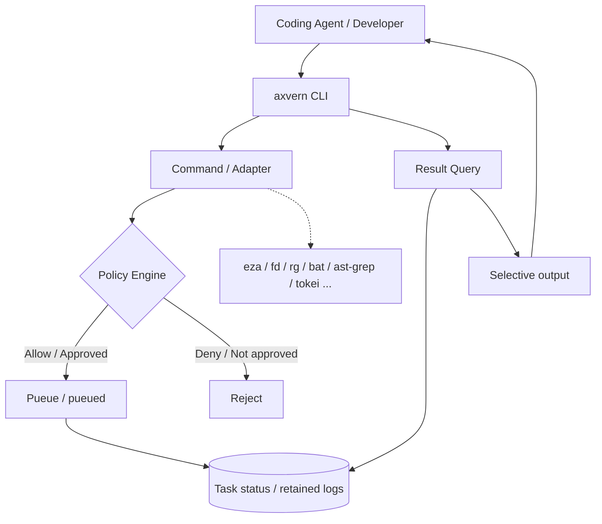

# axvern

**Run commands in the background. Retrieve only the output you need.**

axvern（アクスヴァーン）は、Coding Agentと開発者向けのRust製CLIです。[Pueue](https://github.com/Nukesor/pueue) をバックグラウンド実行基盤として利用し、コマンドの実行管理、保存済みログの部分抽出、開発作業に適したモダンCLIの呼び出しを一つのインターフェースにまとめます。

> [!IMPORTANT]
> **設計・開発準備段階です。** このREADMEのコマンド例は **実装予定のCLI仕様** であり、現時点で動作を保証するものではありません。Pueue連携・引数の安全性・ログ取得方式は事前検証（Spike）の対象です。

## なぜ作るのか

Coding Agentに必要なのは、毎回数千行のビルド・テストログを読むことではありません。**必要なときに、必要な情報だけを、再実行せず取り出せること**です。

従来のコマンド実行には、次のような課題があります。

- 長いテストやビルドが完了するまで、Agentが実行結果を待つ。
- 大量の標準出力がAgentのコンテキストを消費する。
- 一度流れたログを確認するために、同じコマンドを再実行してしまう。
- `ls` / `find` / `grep` などの使い方や出力形式が用途ごとにばらつく。
- リポジトリの概要把握に、複数の調査コマンドを手で組み合わせる必要がある。

axvernはこれらを、**既存CLIへの委譲と、結果の選択的取得**によって解決することを目指します。

## できること（計画中）

### 1. 非同期実行と結果の再利用

```bash
# Pueueにタスクを登録し、実行IDを受け取る
axvern run -- cargo test

# 実行状態を確認し、必要なら完了まで待つ
axvern status <execution-id>
axvern wait <execution-id>

# 保存済みログから必要な部分だけ取得する（再実行しない）
axvern query <execution-id> --errors
axvern query <execution-id> --match "mismatched types"
axvern query <execution-id> --tail 50

# 元ログを確認する
axvern recall <execution-id>
```

`query` と `recall` は、Pueueに残っているログを参照します。ログが削除された場合の復元や、stdout/stderrの完全な分離復元は保証しません。

### 2. モダンCLIを利用したファイル操作・コード調査

```bash
# eza: 一覧
axvern fs list ./src

# fd: パス検索
axvern fs find '*.rs' ./src

# ripgrep: テキスト検索
axvern fs search 'TODO' ./src

# bat: ファイルの一部を閲覧（v0.1追加候補）
axvern fs read ./src/main.rs --from-line 1 --lines 80

# ast-grep: 構文ベース検索（v0.1追加候補）
axvern code search --pattern 'fn $NAME($$$ARGS) { $$$BODY }' ./src
```

既存コマンドを無条件に置換するわけではありません。`find` と `fd` のように引数や探索対象の既定値が異なるものは、**専用サブコマンド**として使い分けます。汎用コマンドの自動置換は初期状態で無効にし、検証済みのルールに限定します。

### 3. パス分析（v0.2）

```bash
axvern fs analyze . --max-depth 3 --format json
```

**`eza` + `fd` + `tokei`** を組み合わせ、指定パスのディレクトリ構成、主要な設定ファイル、言語別のコード統計を統合します。分析ロジックを一から作るのではなく、既存CLIの出力を組み立てる方針です。

### 4. 追加の開発支援（v0.2）

| コマンド（案） | 利用するCLI | 用途 |
| --- | --- | --- |
| `axvern code stats [path]` | `tokei` | 言語別コード統計 |
| `axvern code diff [--staged]` | `git diff` + `delta` | 差分生成と表示 |
| `axvern system disk-usage [path]` | `dust` | 容量の大きい項目を確認 |
| `axvern system processes` | `procs` | プロセスの確認 |
| `axvern text replace ...` | `sd` | テキスト置換（追加候補・変更操作） |

## 仕組み



- **Pueue**: タスクキュー、非同期実行、実行状態、基本ログ保持を担当。
- **axvern**: 実行計画、ポリシー、実行IDの対応付け、ログ検索、結果の整形を担当。
- **モダンCLI**: ファイル操作・解析・表示など個別の処理を担当。

複数ツールを使う `fs analyze` では、個々の実行を追跡し、分析結果を統合する設計です。

## ロードマップ

| リリース | 重点 | 主なコマンド |
| --- | --- | --- |
| **v0.1** | 実行管理・選択的ログ取得 | `run`、`status`、`wait`、`history`、`query`、`recall`、`policy check`、`doctor` |
| **v0.1** | 基本ファイル操作 | `fs list`、`fs find`、`fs search` |
| **v0.1 追加候補** | 部分閲覧・構文検索 | `fs read`、`code search` |
| **v0.2** | パス分析・コード/システム情報 | `fs analyze`、`code stats`、`code diff`、`system disk-usage`、`system processes` |
| **v0.2 追加候補** | ファイル変更 | `text replace` |

詳細な実装順序と受入条件は [ロードマップ](docs/ROADMAP.md) と [検証計画](docs/VERIFICATION.md) を参照してください。

## 実行環境・依存関係

- **Rust**: axvern本体の実装言語。
- **Pueue / pueued**: 実行管理バックエンド。Pueue CLIとデーモンが利用可能であることを想定。
- **各種外部CLI**: 利用するサブコマンドに応じて `eza`、`fd`、`rg` などを使用。
- **OS**: Linux / macOSを目標。互換性はSpikeと統合テストで確認予定。

> インストールコマンド、配布方法、必要バージョンは未確定です。公開・動作検証が済むまで、`cargo install` 等の導入方法は案内しません。

## 安全性と設計上の境界

- `Allow / Ask / Deny` による実行前ポリシーを想定。ただし**OSレベルのサンドボックスではありません**。
- Pueueへのコマンド登録に伴うシェル解釈は、実装前に引数・エスケープ方法を検証します。
- 自動CLI置換は**既定で無効**。未知の引数や非互換なコマンドを勝手に変換しません。
- `sd` 等による変更操作には、読み取り操作とは別の厳格なポリシーを適用します。
- ログには秘密情報が含まれる可能性があります。保存範囲・アクセス権・保持期間はPueueの実態を踏まえて設計します。
- `--dry-run`、LLM要約、独自プロセスマネージャー、Docker連携、RTK連携は初期スコープ外です。

## ドキュメント

設計に関する正本は [`docs/`](docs/README.md) にまとめています。

| 文書 | 内容 |
| --- | --- |
| [Requirements](docs/REQUIREMENTS.md) | プロジェクトの目的・スコープ・非機能要件 |
| [Functional Requirements](docs/FUNCTIONAL_REQUIREMENTS.md) | 機能別要件・要件ID |
| [CLI Specification](docs/CLI_SPEC.md) | コマンド・引数・出力形式 |
| [Architecture](docs/ARCHITECTURE.md) | Pueue連携とシステム境界 |
| [Command Composition](docs/COMMAND_COMPOSITION.md) | **既存CLIの組み合わせによる機能実現方法** |
| [Command Flows](docs/COMMAND_FLOWS.md) | サブコマンドと内部処理フロー |
| [Roadmap](docs/ROADMAP.md) | v0.1〜v0.2の実装計画 |
| [Verification](docs/VERIFICATION.md) | 受入条件・技術検証項目 |
| [References](docs/REFERENCES.md) | 利用ツールと参考資料 |

## 開発方針

**Don't reinvent the command. Compose it.**

既存の優れたCLIが担当できる処理は再実装せず、axvernはそれらをCoding Agentが使いやすい形に接続することに集中します。

ライセンス、コントリビューション手順、リリース・インストール方法は決定後に追記します。
