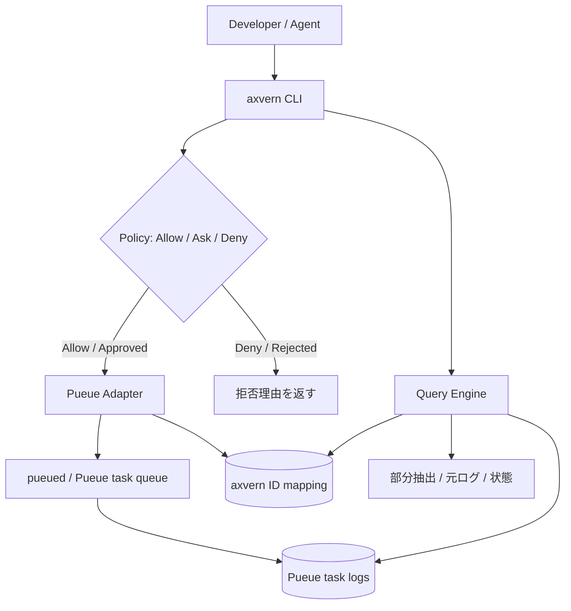

# アーキテクチャ・利用フロー

> 出典: 2026-10-13時点の統合版 `REQUIREMENTS.md`。要件ID・受入条件IDは維持。

## 3. 想定利用フロー

### 3.1 ユースケース

| ID | 操作 | 期待する結果 |
| --- | --- | --- |
| UC-01 | コマンドを登録する | 実行IDとQueued/Running等の状態をすぐに返す |
| UC-02 | 状態を確認する | 実行中・待機中・完了・失敗等を取得できる |
| UC-03 | 終了を待つ | 完了まで待機し、タイムアウトの場合も状態を返す |
| UC-04 | エラー候補だけ取得する | 失敗情報と該当ログの位置を取得できる |
| UC-05 | 特定範囲を問い合わせる | 保存済みログから検索・行範囲抽出できる |
| UC-06 | 完全ログを確認する | Pueueに残っている元ログを取得できる |
| UC-07 | 実行可否を調べる | 実際には登録せずポリシー判定する |
| UC-08 | 診断する | デーモン接続、権限、設定、ログ可用性を確認する |
| UC-09 | 互換性のある基本コマンドを登録する | 有効化された置換ルールに従いモダンCLIへ委譲する |
| UC-10 | 専用サブコマンドで探索する | `eza` / `fd` / `rg` を使って目的別の出力を得る |

