> **導入フェーズ**：`run/status/wait/history`はv0.1、コードベース調査はv0.2、`query/recall`はv0.3、性能分析はv0.4+。この文書の図は最終的な構成を表す。

# axvern サブコマンド実現方式・CLI組み合わせ設計

> 対象: v0.1〜v0.2 / 設計案。各CLIの入出力・フラグは導入バージョンで固定し、Spikeと統合テストで確認する。
>
> 関連: [FUNCTIONAL_REQUIREMENTS.md](./FUNCTIONAL_REQUIREMENTS.md) / [CLI_SPEC.md](./CLI_SPEC.md) / [ROADMAP.md](./ROADMAP.md) / [COMMAND_FLOWS.md](./COMMAND_FLOWS.md)

## 1. 原則とCLI対応表

この文書は「axvernの各サブコマンドの要件を**どの既存CLIのどの機能で満たし、足りない部分を何行程度のロジックで補うか**」を示す。Pueueは非同期実行・状態・ログ取得の基盤であり、`fd`や`tokei`の解析機能そのものは提供しない。*ポリシー、メタデータ管理、抽出、集約*はaxvernの責務。

| axvern | 委譲先CLI | 組み合わせの要点 | バージョン |
|---|---|---|---|
| `run` | `pueue add` | 実行計画を検証後、1タスクを登録 | v0.1 |
| `status` / `history` | `pueue status --json` | axvern管理IDの対応表でフィルタ | v0.1 |
| `wait` | `pueue wait` / `pueue status` | 対象タスクの完了と終了状態を確認 | v0.1 |
| `query` / `recall` | `pueue log` | 保存済みログの検索・範囲抽出 / 全文返却 | v0.1 |
| `policy check` | 外部CLIなし | 独自ルール評価のみ | v0.1 |
| `doctor` | `pueue` + 各CLIのバージョン確認 | 設定・依存・デーモン・ログ可用性の確認 | v0.1 |
| `fs list` | `eza` | 構造と表示を明示的に固定 | v0.1 |
| `fs find` | `fd` | パス・拡張子・ignoreフラグへ変換 | v0.1 |
| `fs search` | `rg` | 一致位置・前後文脈を必要な分だけ取得 | v0.1 |
| `fs read` | `bat` | 行範囲とページャ無効化 | v0.1推奨 |
| `code search` | `ast-grep` (`sg`) | 言語・ASTパターンを渡して結果を変換 | v0.1推奨 |
| `code stats` | `tokei` | 言語別集計JSONを整理 | v0.2 |
| `code diff` | `git diff` + `delta` | Gitが差分生成、deltaが表示装飾 | v0.2 |
| `system disk-usage` | `dust` | 容量の大きいパスを読み取り専用で集計 | v0.2 |
| `system processes` | `procs` | プロセス一覧のフィルタ・列整形 | v0.2 |
| `fs analyze` | **`eza` + `fd` + `tokei`** | 木構造・設定ファイル検出・言語別統計を統合 | v0.2 |
| `text replace` | `sd` | 明示的な対象ファイルにだけ置換（承認必須） | v0.2候補 |

> `eza --code` は単体で簡易な言語統計を表示できるが、機械処理しやすい詳細な言語統計には `tokei --output json` を採用する。`dust` はサイズの深掘りが必要な場合の**任意**拡張とし、`fs analyze` の必須依存にはしない。

## 2. 共通の「委譲→保存→抽出」手順

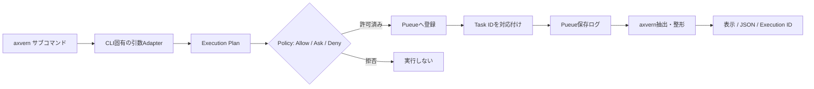

- CLIのオプションを**独自サブコマンドの明示的な引数へマッピング**する。完全互換のエミュレーションはしない。
- `pueue add` のシェル文字列化はPueue Adapterに集約。任意入力の連結や、パイプ文字列の素通しを禁じる。
- 実行直後はIDを返し、結果取得コマンドは**再実行せず**Pueueに保存されたログを読む。
- `rg` の「一致なし」など、終了コードが正常な検索結果を示すケースは実行失敗と区別する。
- Pueueログは削除され得る。ログの無期限保持や完全なstdout/stderr分離は保証しない。

## 3. v0.1: ファイルの一覧・探索・検索・閲覧

### 3.1 `axvern fs list PATH` = eza

要件: ディレクトリのエントリと階層を指定した深度で閲覧する。

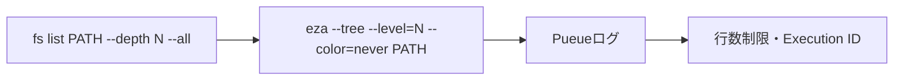

- `--all` 指定時のみ `eza --all` を追加。`--tree` が不要な浅い一覧は非再帰の `eza` を利用可能。
- ANSI装飾を無効化し、機械的なパースを前提にしない。出力は表示文字列であって安定した構造化APIではない。

### 3.2 `axvern fs find PATTERN PATH` = fd

要件: ファイル・ディレクトリ名を対象に検索する。

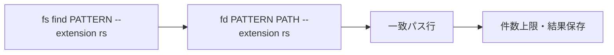

- `--hidden`、`--no-ignore`、`--max-depth` はfdの同等フラグに写像する。
- 既定のパターン解釈は正規表現。globを使うなら専用`--glob`を設け `fd --glob` に変換する。
- `find`コマンドとの自動・全面的な互換変換には用いない。

### 3.3 `axvern fs search PATTERN PATH` = ripgrep

要件: ファイル内の文字列を高速検索し、位置を示す。

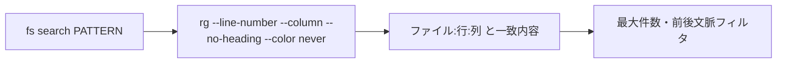

- `--fixed-strings`、`--glob`、`--hidden`、`--no-ignore`、前後文脈（`-C`相当）を明示的に公開。
- 検索結果が0件の終了コード1と、CLI起動失敗などのエラーを区別する。
- 将来の構造化出力には`rg --json`を使用できるが、JSON Linesイベントを読み解くAdapterが必要。

### 3.4 `axvern fs read FILE --from-line N --lines M` = bat

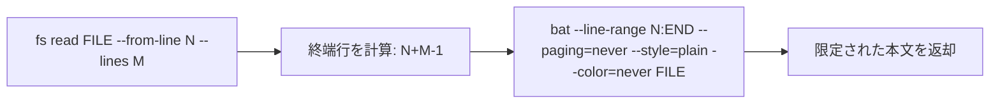

- `bat`の表示機能はテキスト閲覧用。*元ファイルのバイト完全復元*を請け負わない。
- 巨大ファイルの全文を表示させない。バイナリやディレクトリを入力として拒否する。

## 4. v0.1推奨〜v0.2: コード・システムの分析

### 4.1 `axvern code search` = ast-grep

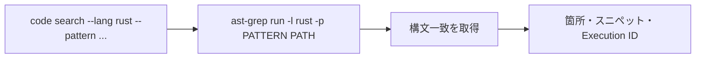

- テキスト検索ではなく構文検索。言語・パターン・対象を渡す。利用可能なJSON出力は導入バージョンで検証する。

### 4.2 `axvern code stats` = tokei

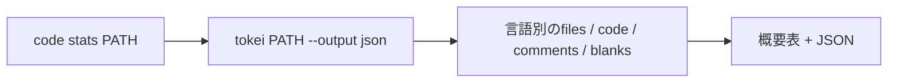

- `tokei --files` は個別ファイルの統計が必要な場合にだけ利用。
- **注意**: ビルド時の機能設定によりJSON出力が無効な配布物がある。`doctor`/Spikeで実行可能か検証する。

### 4.3 `axvern code diff` = git diff + delta

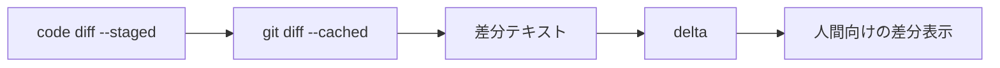

- 差分の*真実のソース*はGit。deltaは描画ツール。構造化形式やAgent向けの厳密な差分は`git diff`側から取得する。
- `git diff`の出力を`delta`へ流すとき、Pueueへ任意のパイプライン文字列を渡さない。**固定テンプレートのラッパー**か段階実行で処理する（Spike対象）。

### 4.4 `axvern system disk-usage` = dust / `system processes` = procs

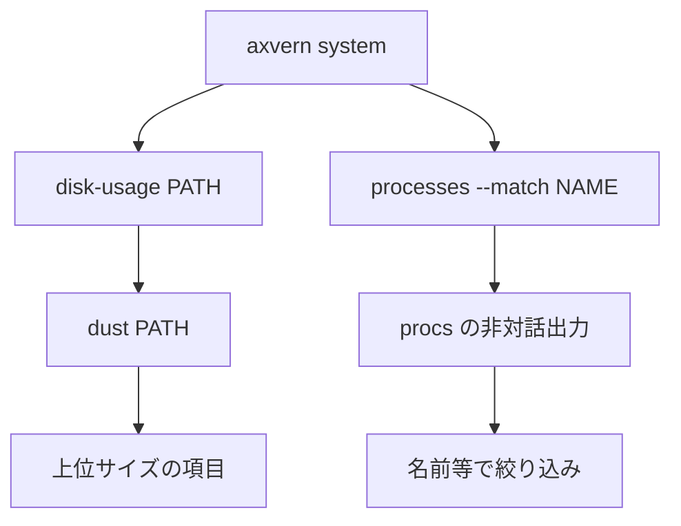

- `dust`の既定出力は可視化向け。構造化APIを提供する場合は別途Adapterが必要。
- `procs`の機械可読出力とフィルタの正確なフラグは導入バージョンのSpikeで確定する。
- どちらも読み取り専用として扱う。対話・監視の継続表示は含めない。

### 4.5 `axvern text replace` = sd（v0.2候補）

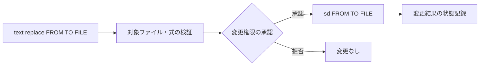

- `sd`は`sed`の完全互換ではない。複数ファイルへの一括書換えはデフォルトで拒否する。
- 置換前のdiff確認や復元については、別の受入条件とし、実装しないうちは保証しない。

## 5. v0.2: `fs analyze` の組み合わせ詳細

`fs analyze` は新しい解析エンジンを開発するのではなく、**既存の3つのCLIが出した事実を集約する**。

| 分析項目 | 既存CLIの使い方 | axvernに必要な追加ロジック |
|---|---|---|
| ルート以下の階層構造 | `eza --tree --level=N --color=never PATH` | 最大深度の適用、ツリーのテキスト表示 |
| コード言語構成 | `tokei PATH --output json` | JSONの言語別合計・比率の算出 |
| コード行数とコメント比率 | `tokei PATH --output json` | code/comments/blanksから集計 |
| 構成ファイルの存在 | `fd`で`Cargo.toml` / `package.json` / `pnpm-workspace.yaml`等を発見 | パスを既知の構成種類に分類、根拠パスを保持 |
| ファイル数・ディレクトリ数 | `fd`でタイプ別に列挙 | ファイル・フォルダの件数を算出。対象上限を適用 |
| 詳細な容量分布（任意） | `dust PATH` | 結果を別セクションで扱う |

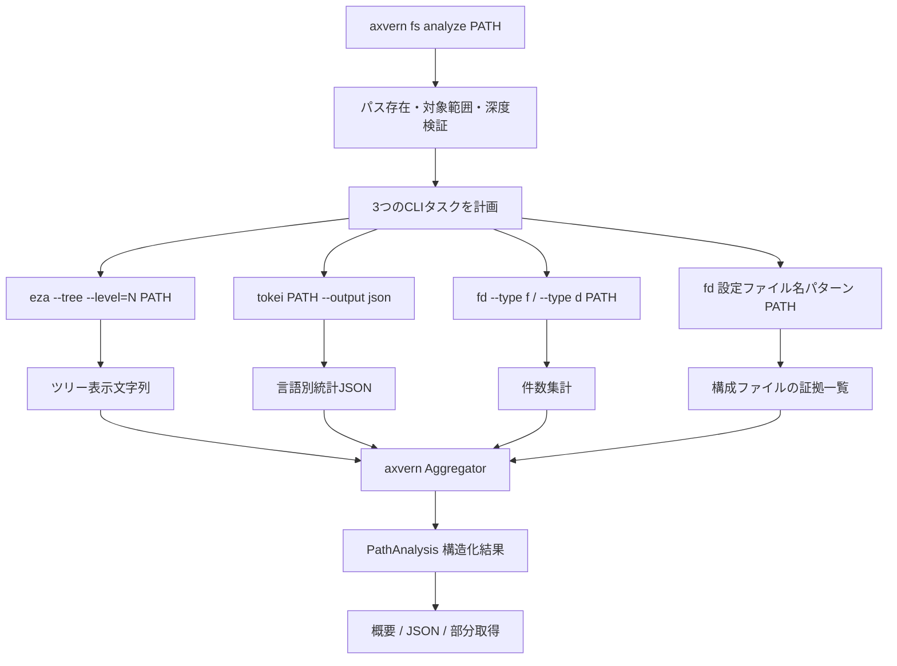

**実行単位の注意:** 分岐するCLIのすべてについて個別にポリシー判定し、PueueタスクIDを記録する。親の**Analysis ID**はaxvernで発行する。結果取得時に元コマンドを再実行しない。構造化分析結果をPueueのログだけに依存させない設計が必要なため、一時JSONスナップショットの保存範囲・期限を別途定義する。

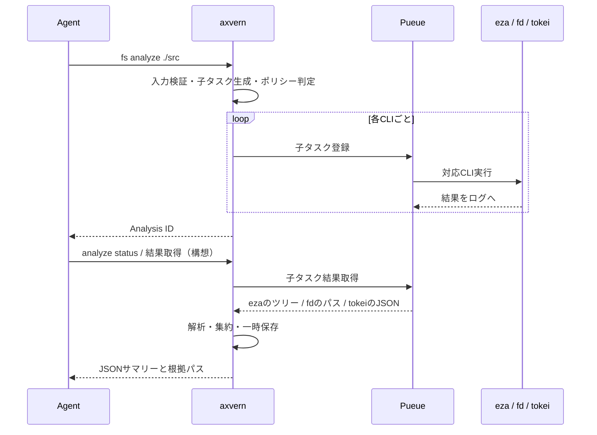

> `analyze status` / 解析ID専用照会はインターフェース案であり、既存のCLI_SPECへ追加する際に確定する。v0.2の初期実装では、既存の`status`/`query`を拡張する方式も検討する。

### 出力スキーマ案

```json
{
  "analysis_id": "example",
  "path": "./src",
  "tree": "(ezaの限定ツリー)",
  "languages": [{"name": "Rust", "files": 12, "code": 2300, "comments": 180}],
  "inventory": {"files": 20, "directories": 4},
  "detected_configs": [{"kind": "cargo", "path": "./Cargo.toml"}],
  "partial_failures": [],
  "evidence": {"tree": "task-1", "stats": "task-2", "files": "task-3"}
}
```

※上記は**架空のサンプル**。`fd`の対象集合と`tokei`の対象集合にはignoreや言語認識の差があり、ファイル数は一致するとは限らない。その意味をフィールド名・説明文で区別する。

## 6. 実行管理コマンドが使うCLIの機能

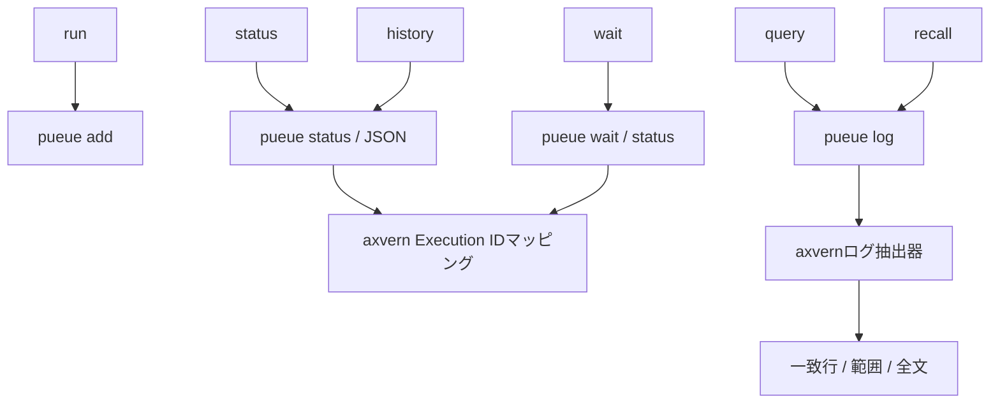

- `query --match`は保存済みログを読み取りマッチングする。`query --errors`は**ヒューリスティックな抽出**であり、すべてのCLIの失敗を完全検出すると保証しない。
- `history`で同一Pueueデーモンの他タスクを表示しないよう、axvern側でタスク所有情報を維持する。
- `policy check`は外部コマンドを呼ばない。`doctor`は`pueue`・`eza`・`fd`・`rg`・`bat`・`ast-grep`・`tokei`・`dust`・`procs`・`delta`・`sd`の存在・バージョン・必要機能を検査する（バージョン別に必須/任意を判定）。

## 7. 未解決の実装Spike / 受入条件

| 検証事項 | 合格条件 |
|---|---|
| PueueのCLI引数とシェル安全性 | 空白・引用符・制御文字・不審な引数が意図せずシェル展開されない |
| Pueueログ形式・寿命 | `query`/`recall`が再実行なしで動き、削除済みログは明確にエラーになる |
| CLI出力の非対話適合 | 色・ページャ・罫線等でパースが壊れない |
| `tokei --output json` | 配布バイナリでJSON出力が有効、各言語のキーを解析できる |
| `fd`・`eza`・`tokei`の対象差 | 隠しファイル・ignore・シンボリックリンク・エラー時の意味を明示できる |
| 複合タスクの部分失敗 | `fs analyze`で1ツールが失敗しても、成功した事実を残して不足を表示できる |
| `git diff`と`delta`の合成 | 任意のシェル文字列を受け取らず、決め打ちの安全な合成で実行できる |
| `sd`の副作用管理 | 対象・承認・終了状態が追跡でき、誤って一括書換えしない |

## 8. 公式資料

- [Pueue](https://github.com/Nukesor/pueue)
- [eza manpage](https://github.com/eza-community/eza/blob/main/man/eza.1.md)
- [fd](https://github.com/sharkdp/fd)
- [ripgrep](https://github.com/BurntSushi/ripgrep)
- [bat](https://github.com/sharkdp/bat)
- [ast-grep](https://ast-grep.github.io/)
- [tokei](https://github.com/XAMPPRocky/tokei)
- [dust](https://github.com/bootandy/dust)
- [procs](https://github.com/dalance/procs)
- [delta](https://github.com/dandavison/delta)
- [sd](https://github.com/chmln/sd)
