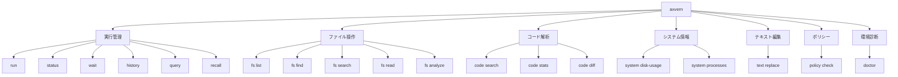
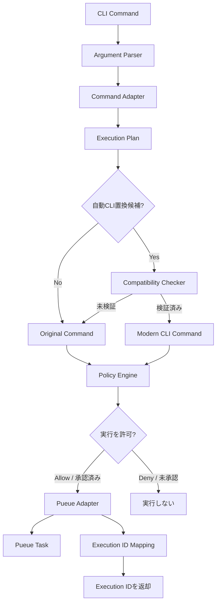
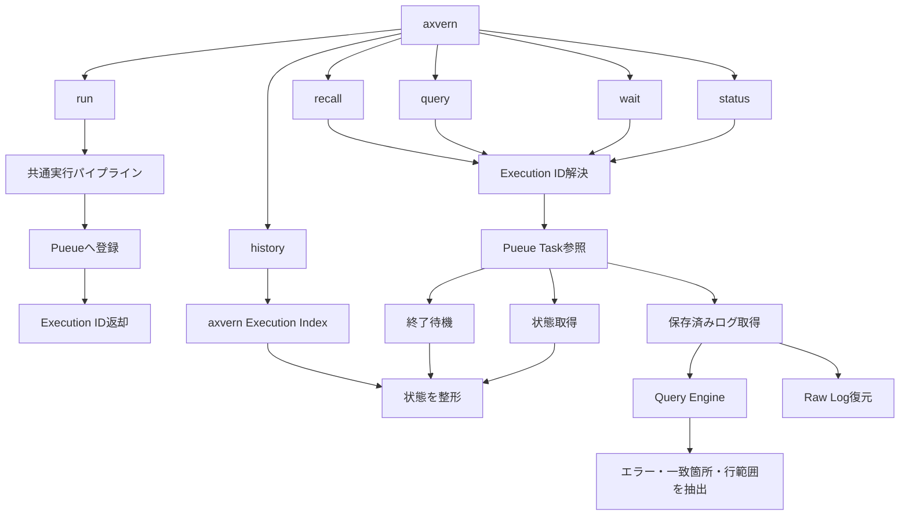
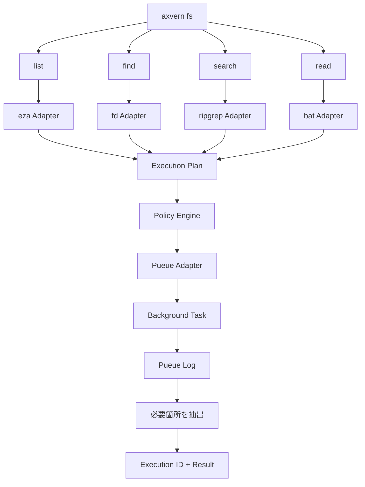
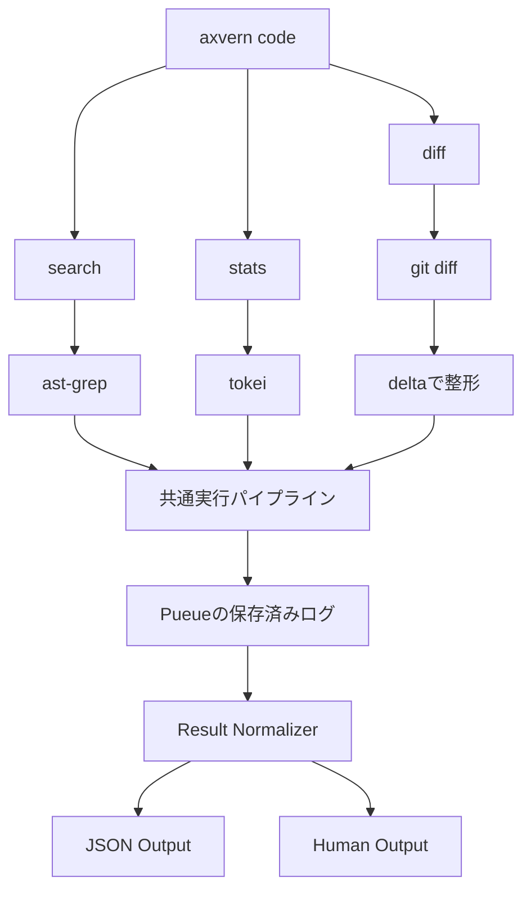
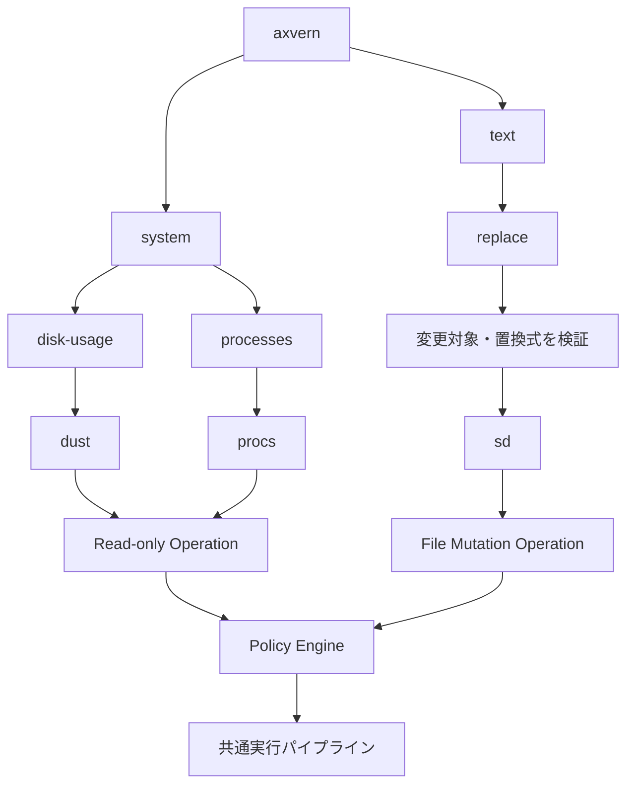
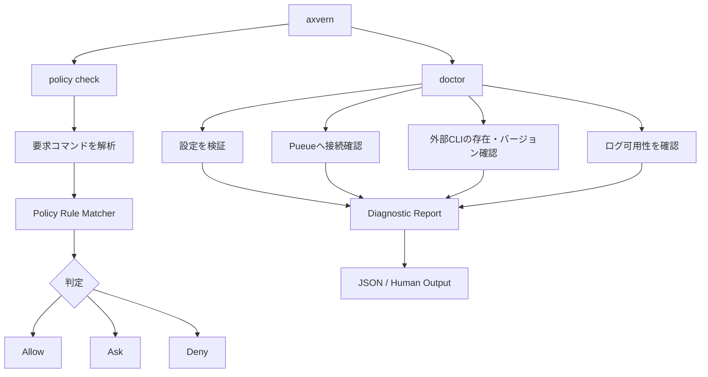
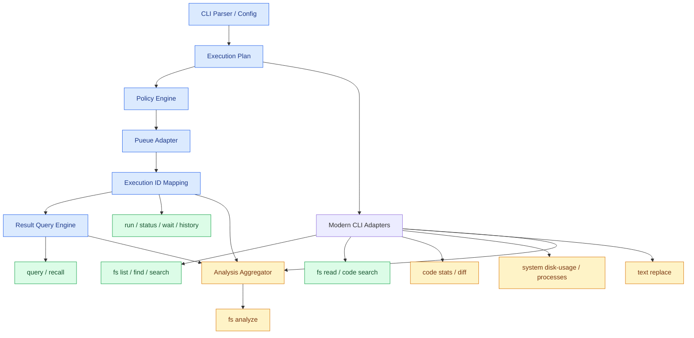

# axvern サブコマンド内部処理フロー

> 対象: v0.1.0〜v0.2.0 / 設計案  
> 関連: [REQUIREMENTS.md](./REQUIREMENTS.md)、[ARCHITECTURE.md](./ARCHITECTURE.md)、[CLI_SPEC.md](./CLI_SPEC.md)、[ROADMAP.md](./ROADMAP.md)

## 1. サブコマンド一覧



| マイルストーン | 対象 |
|---|---|
| v0.1 必須 | `run`, `status`, `wait`, `history`, `query`, `recall`, `policy check`, `doctor`, `fs list`, `fs find`, `fs search` |
| v0.1 推奨 | `fs read`, `code search` |
| v0.2 | `fs analyze`, `code stats`, `code diff`, `system disk-usage`, `system processes` |
| v0.2 候補 | `text replace` |

## 2. 共通実行パイプライン

各サブコマンドは実行系の処理を再実装せず、**Execution Plan → Policy Engine → Pueue Adapter → Execution ID** を再利用する。



**設計上の条件**

- 自動CLI置換は既定で無効。引数・挙動の互換性を検証した許可リスト方式のみ。
- 置換前と置換後の両方にPolicy Engineを適用する。
- `Ask` 判定を非対話環境で黙って `Allow` にしない。
- Pueueがシェル経由で実行する場合の引数エスケープはPueue Adapterに集約する。任意の引数を単純連結しない。
- タスク登録時点の成功と、実際のコマンドの終了コードは区別する。
- Pueue側のログ寿命に依存するため、消去済みログの復元は保証しない。

### Execution Plan（概念型）

```rust
struct ExecutionPlan {
    program: String,
    args: Vec<String>,
    cwd: PathBuf,
    operation: OperationKind,
}
```

## 3. 実行管理系コマンド

対象: `run`, `status`, `wait`, `history`, `query`, `recall`



`query` と `recall` は**保存済みの結果だけを参照**し、元のコマンドを再実行しない。統合ログからstdout/stderrの完全な分離を保証しない。

## 4. ファイル操作系コマンド

対象: `fs list`, `fs find`, `fs search`, `fs read`



| Adapter | 内部処理 |
|---|---|
| `eza` | 指定パス、深さ、隠しファイル、表示形式を引数に対応付ける |
| `fd` | パターン、拡張子、検索深度、ignore条件を対応付ける |
| `rg` | 検索文字列、検索範囲、前後文脈、ignore条件を対応付ける |
| `bat` | ファイル、行範囲を指定し、ページャや装飾を抑制する |

> `find` → `fd` や `grep` → `rg` を無条件で書き換えない。互換性の差は明示する。

## 5. パス分析コマンド（v0.2）

対象: `fs analyze`。`eza` で階層を、`tokei` で言語別統計を、`fd` で設定ファイルを調べる。ツールの結果を統合するのがaxvernの責務。

```mermaid
flowchart TD
    A["axvern fs analyze PATH"] --> B["Path Validator"]
    B --> C["Analysis Planner"]
    C --> D["Analysis ID発行"]

    D --> PE["共通Policy / Pueue経路: eza"]
    D --> PT["共通Policy / Pueue経路: tokei"]
    D --> PF["共通Policy / Pueue経路: fd"]

    PE --> H["Pueue Task E"]
    PT --> I["Pueue Task T"]
    PF --> J["Pueue Task F"]

    H --> K["結果回収"]
    I --> K
    J --> K
    K --> L["Analysis Aggregator"]
    L --> M["Analysis Schema"]
    M --> N["JSON / Human Output"]
```



- `Analysis ID` は複数の `Pueue Task ID` を関連付ける。
- `--max-depth` と件数・時間制限で過大な探索を抑える。
- `tokei --output json` の解析結果を用い、事実と推測を区別する。
- 一部のCLIが失敗した場合は、成功した部分と失敗した部分の両方を返す。
- 将来の依存関係解析には `cargo metadata` 等を追加できるが、v0.2の必須範囲には含めない。

## 6. コード解析系コマンド

対象: `code search`, `code stats`, `code diff`



`delta` は差分生成器ではなく表示用フォーマッタ。`git diff` の出力を整形する。パイプラインの実現方式は安全な引数処理・終了コード伝播を含めて検証する。

## 7. システム情報・テキスト編集系

対象: `system disk-usage`, `system processes`, `text replace`（v0.2候補）



`text replace` は副作用を持つため、ファイルの変更範囲を明示し、読み取り操作より厳格なPolicyを適用する。

## 8. Policy Engine / Doctor

対象: `policy check`, `doctor`



どちらも原則として対象コマンドを実行しない。`doctor` は診断のための読み取り専用チェックに限定する。

## 9. 実装依存関係



**設計原則:** 実行ポリシー、バックグラウンド実行、ログ参照は共通基盤へ集約し、個々のサブコマンドは引数変換・複合実行の組み立て・結果整形を主に担当する。
