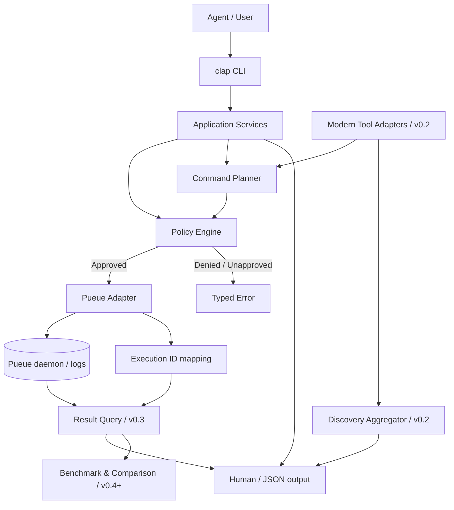
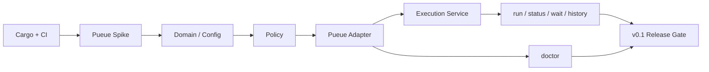
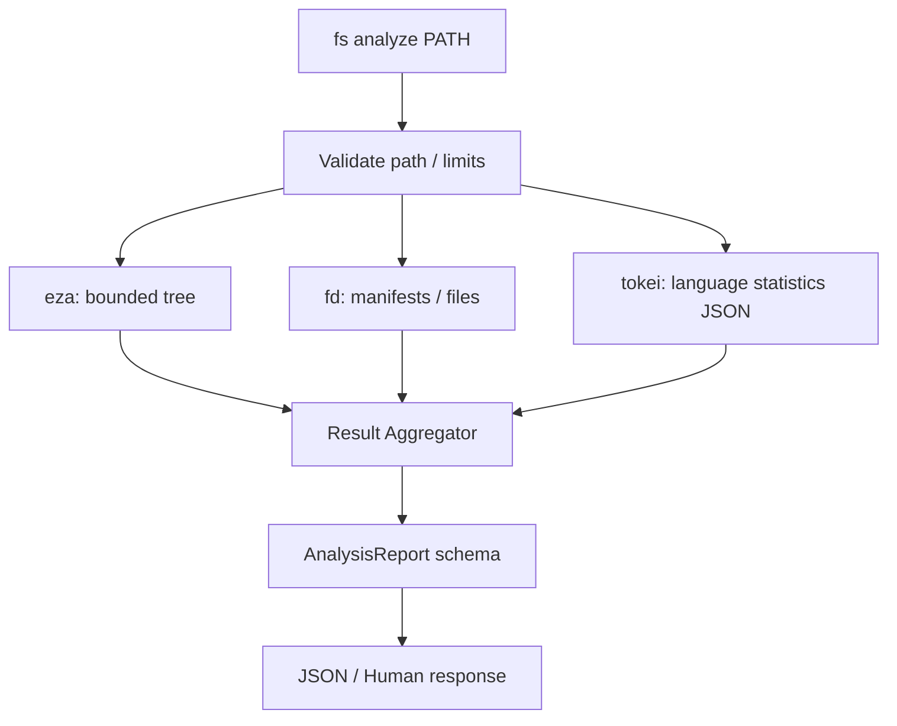
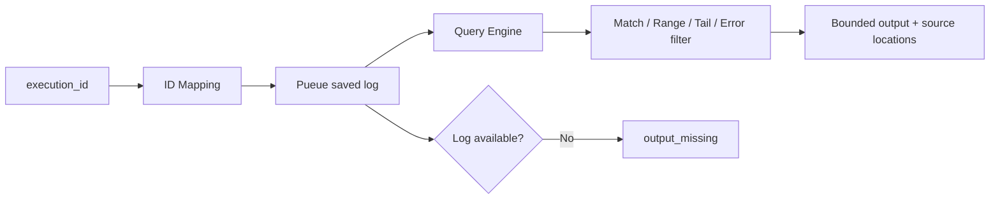
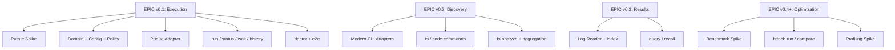

# axvern 実装設計・作業計画

> Status: Proposal / 未実装。対象は v0.1〜v0.4+。リリース順序は [ROADMAP.md](./ROADMAP.md)、振る舞いの要求は [FUNCTIONAL_REQUIREMENTS.md](./FUNCTIONAL_REQUIREMENTS.md)、公開CLI契約は [CLI_SPEC.md](./CLI_SPEC.md) を正本とする。本書は**それらを何から、どのモジュールで、どう作るか**に特化する。

## 1. 設計原則と最初に決めること

1. **Native first**。Rust製の薄いCLIを作り、Pueueや既存のCLIを再実装しない。Dockerは必須にしない。
2. **実行計画と実行を分離**。各サブコマンドは `ExecutionPlan` を構築する。Pueueとの通信は一つのAdapterだけが担う。
3. **副作用を隠さない**。自動置換はopt-inかつ互換性を実証した限定ルールのみ。外部コマンドの引数文字列は安易に結合しない。
4. **機械可読を先に設計**。各操作には安定したJSON契約を用意し、Agentが表示テキストを推測解析しなくて済むようにする。
5. **失敗を値として扱う**。`missing_tool` / `daemon_unavailable` / `policy_denied` / `task_not_found` / `output_missing` / `partial_result` を区別する。
6. **機能の先取りをしない**。v0.1では独自検索エンジンを作らない。v0.2の調査は新鮮なコマンド結果を集約する。結果再検索はv0.3から。

### 実装前Spike（必須）

| ID | 検証 | 合格条件 | 成果物 |
| --- | --- | --- | --- |
| SP-01 | Pueueの登録・状態・完了待ち・JSON出力・エラーコード | バージョン固定で実際の入出力例が得られる | `tests/fixtures/pueue/` |
| SP-02 | Pueueへスペース・引用符・改行を含む引数を渡す | 意図しないシェル解釈／コマンド注入を起こさない方式を立証 | 引数エスケープ方針とテスト |
| SP-03 | PueueのID、ログ保持・削除・daemon再起動 | 参照の失効、タスク衝突、可用性を説明できる | タスクID仕様 |
| SP-04 | macOS/Linuxの `pueue` 実行環境 | daemon起動、PATH、権限、CLIバージョンを診断できる | `doctor`検査一覧 |

> **重要**：Pueueの実際の引数仕様・JSONスキーマを調べる前に、架空のフラグや構造体へ依存したコードを書かない。Spikeの事実を `REFERENCES.md` とfixtureに記録する。

## 2. 推奨構成

v0.1は単一Cargo packageから始める。`core`の共有需要が生じるまで複数crate化しない。

```text
axvern/
├── Cargo.toml
├── Cargo.lock
├── README.md
├── docs/
│   ├── IMPLEMENTATION_PLAN.md
│   └── ...
├── src/
│   ├── main.rs                 # 終了コードとエラー表示
│   ├── cli.rs                  # clapのパーサとサブコマンド定義
│   ├── config.rs               # 設定読込・検証
│   ├── error.rs                # エラー分類
│   ├── output.rs               # JSON / human serializer
│   ├── domain/
│   │   ├── execution.rs        # ExecutionPlan, ExecutionId, TaskState
│   │   ├── policy.rs           # Allow / Ask / Deny
│   │   └── result.rs           # 実行結果のメタデータ
│   ├── services/
│   │   ├── execution.rs        # 登録・照会・待機ユースケース
│   │   ├── doctor.rs           # 診断項目の集約
│   │   └── discovery.rs        # v0.2: 調査結果の統合
│   ├── adapters/
│   │   ├── pueue.rs            # 外部Pueue CLIへの唯一の入口
│   │   └── tools/             # v0.2: 外部CLIの引数と結果変換
│   │       ├── mod.rs
│   │       ├── eza.rs
│   │       ├── fd.rs
│   │       ├── rg.rs
│   │       ├── bat.rs
│   │       ├── tokei.rs
│   │       └── ast_grep.rs
│   ├── store/                  # v0.1: ID対応。v0.3: 検索索引
│   │   └── execution_index.rs
│   ├── query/                  # v0.3で導入
│   └── perf/                   # v0.4+で導入
└── tests/
    ├── integration/
    ├── fixtures/
    └── golden/
```

**依存ライブラリの候補**：`clap`（引数）、`serde` / `serde_json`（契約）、`tokio`（プロセスI/Oと待機）、`thiserror`（型付きエラー）、`tracing`（診断ログ）。SQLite等はv0.1の要件ではない。Rustの標準APIで足りる部分はそのまま使う。

## 3. ロジックの境界



### 最小ドメイン契約（概念例、API確定前）

```rust
struct ExecutionPlan {
    program: OsString,
    args: Vec<OsString>,
    cwd: PathBuf,
    origin: OperationKind,
}

struct ExecutionRef {
    execution_id: String,
    backend: String, // "pueue"
    backend_task_id: String,
}

enum PolicyDecision { Allow, Ask, Deny }
```

- `ExecutionPlan`は入力を正規化した値。**シェルコマンド文字列ではない**。最終的なPueueへの変換はAdapterだけが実装する。
- `Ask`は非対話環境で自動許可しない。承認が必要なら明示的なエラーとして返す。
- `ExecutionRef`を公開コマンドの参照キーにし、PueueのIDと区別する。失効時は`task_not_found`等を返す。
- 実行ポリシーは外部ツールに渡す最終的なコマンドも評価する。`fs`サブコマンドも例外にしない。

## 4. 各フェーズで「何をどう作るか」

### Phase 1 / v0.1：実行管理を使える状態にする

| 順 | 作業単位 | 実装内容 | 検証 |
| --- | --- | --- | --- |
| 1 | 初期セットアップ | Cargo、fmt/clippy/test、CI、最小README | `cargo fmt --check && cargo clippy -- -D warnings && cargo test` |
| 2 | Pueue Spike | SP-01〜04を実測しfixture化 | ダミーCLIで空白・引用符・終了コードを確認 |
| 3 | Domain + Config | ID、状態、ExecutionPlan、設定・エラー型 | 不正値・未知設定の単体テスト |
| 4 | Policy | Allow/Ask/Deny、非対話時Askの拒否 | Deny時にタスク登録されない |
| 5 | Pueue Adapter | 登録・status・wait・task列挙・接続エラー | mockと実Pueueの統合テスト |
| 6 | Execution Service | IDの割当、Pueue IDとの対応、状態正規化 | 同時登録、daemon再起動、参照失効 |
| 7 | CLI + Output | `run/status/wait/history/doctor`とJSON | golden test、終了コード一貫性 |



**公開コマンド例**（すべて計画上の構文）：

```bash
axvern run -- cargo test
axvern status ex_123 --format json
axvern wait ex_123
axvern history --limit 20
axvern doctor
```

**v0.1の非目標**：`query`、`recall`、独自ログコピー／全文検索、ファイル分析、性能比較。

### Phase 2 / v0.2：コードベース調査のAdapterを作る

| サブコマンド | 既存CLI | axvernが実装するもの | 結果 |
| --- | --- | --- | --- |
| `fs list` | `eza` | パス・階層・隠し項目の指定、出力制限 | 一覧 |
| `fs find` | `fd` | パターン・拡張子・ignore挙動を正規化 | パス集合 |
| `fs search` | `rg` | マッチ行／前後行・対象パス、終了コード1=未検出の扱い | 検索一致集合 |
| `fs read` | `bat` | 行範囲指定、非対話・無色表示 | 指定した本文 |
| `code search` | `ast-grep` | 言語・ASTパターンと出力変換 | 構造検索一致集合 |
| `code stats` | `tokei` | JSONを正規化 | 言語別統計 |
| `fs analyze` | `eza` + `fd` + `tokei` | 並列依頼、集計、部分失敗、由来の明記 | パス分析結果 |



**重要な実装制約**：`eza`の人間向けツリー出力を安定した機械可読フォーマットと見なさない。集計に必要な値は`fd`と`tokei`などのより適切な出力から得て、`eza`は構造の表示用に使う。設定ファイルの検出は**存在確認**であり、ビルド構成や依存関係の完全理解を意味しない。複数Pueueタスクの結果集約は部分失敗のままでも返せるようにする。

**v0.2の追加候補（非ゲート）**：`git diff` + `delta`、`dust`、`procs`。破壊的な`sd`は別の承認・変更テストが整うまで候補に留める。

### Phase 3 / v0.3：結果再利用を提供する

| 作業 | 実装 | 必須検証 |
| --- | --- | --- |
| Log Reader | Pueueログの参照、削除済み・不完全なログの区別 | 再実行しない |
| Query Engine | `--match` / `--errors` / `--tail` / `--from-line` / `--lines` | 行番号・文脈・一致数を返す |
| Result Index | 実行ID・バックエンドID・ログ位置の参照 | `history`と不整合を生まない |
| Retention | 必要時のみ独自一時コピー、TTL・容量制限・削除 | 秘密情報・アクセス権を検査 |
| CLI | `query` / `recall` / `logs`（仮） | 標準ログ消失を明示 |



### Phase 4 / v0.4+：測定→比較→原因調査

| サブコマンド案 | 利用候補 | 必要なロジック |
| --- | --- | --- |
| `bench run` | `hyperfine` | 安全な反復実行の事前確認、ウォームアップ、環境記録、結果読込 |
| `bench compare` | `hyperfine` JSON結果 + axvern | ベースラインと比較対象の照合、分布・誤差・環境差の表示 |
| `profile` | `samply` / `flamegraph`等 | OS・権限検証、対象プロセス選択、生成成果物の参照 |
| ビルド分析（将来） | Cargoや各ビルドシステムの計測機能 | 対象環境に応じたAdapter。汎用CLIだけで原因を断定しない |

**性能比較の正しさ**：ベンチマークはコマンドを複数回実行する。副作用のあるコマンドは初期状態では対象外。変更前後の測定条件・リビジョン・ばらつきを記録し、`faster`の断定ではなく観測値と根拠を返す。

## 5. テスト戦略

- **Unit**：引数変換、JSON出力、ID対応、状態遷移、Policy判定、検索条件。
- **Contract**：Pueue、`tokei`、`rg`、`ast-grep`などの出力fixtureを固定し、Adapterの仕様変更を検出。
- **Integration**：隔離したPueue daemon / 設定 / 一時ディレクトリで実行。ユーザーの既存キューに混入しない。
- **End-to-end**：`run → status → wait`、`fs analyze`の部分失敗、`query`から元の位置への参照、性能比較の再現。
- **Security**：注入しそうな引数、権限不足、シンボリックリンク、巨大ログ、秘密情報、Askを非対話で処理するケース。
- **Cross-platform**：少なくともLinux/macOSでCIを通し、ツール不在時は`doctor`で具体的に報告する。

## 6. Issue分割テンプレート

エピックはPhase単位、Sub Issueは**依存を満たす単体成果物**単位とする。Issueには「目的 / 非対象 / 実装箇所 / 前提 / 検証方法 / 完了条件」を記載する。



## 7. 作業開始時チェックリスト

- [ ] `SP-01〜04`を実環境で検証し、既知のPueue仕様をfixtureに保存する
- [ ] v0.1の公開CLI・JSONレスポンスをスナップショットテストで固定する
- [ ] Pueue IDの失効と他ツールによるタスク操作を扱う
- [ ] `docs/CLI_SPEC.md`と実装の引数・終了コードが一致する
- [ ] 新規Adapterを追加するときはCLIバージョン、未導入時のエラー、ポリシー、ログ参照をテストする
- [ ] v0.3より前に`query`が使えるとREADMEなどで誤認させない
- [ ] v0.4でベンチマーク対象を繰り返し実行する前に副作用を確認する
