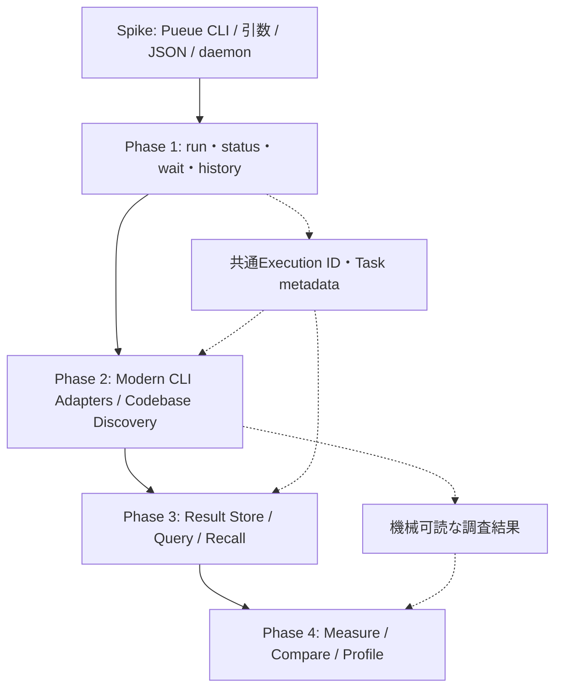
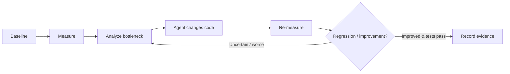

# axvern ロードマップ：実行 → 調査 → 結果活用 → 性能最適化

> この文書はリリース順序の正本。v0.3・v0.4は計画上の目標で、実装済みではない。従来のM0〜M8計画は、この4フェーズに置き換える。

## フェーズとリリースゲート

| フェーズ | リリース目標 | 目的 | 必須コマンド・機能 | 完了ゲート |
| --- | --- | --- | --- | --- |
| Phase 1 | v0.1 | Pueueによる非同期コマンド実行 | `run`, `status`, `wait`, `history`, `doctor`、実行ID対応、最低限のPolicy | 1回だけタスク登録でき、状態・終了コードを参照できる。安全な引数処理と失敗判定が成立する |
| Phase 2 | v0.2 | スマートなコードベース調査 | `fs list/find/search/read/analyze`, `code search/stats`、Modern CLI Adapter | eza/fd/rg/bat/tokei/ast-grepを用途別に組合せ、構造化結果と依存不足を扱える |
| Phase 3 | v0.3 | 出力の一時保存・選択的検索 | `query`, `recall`, `logs`（名称案）、取得範囲・ログ欠損・保持戦略 | **元コマンドを再実行せず**部分抽出できる。ログ消失を誤魔化さない |
| Phase 4 | v0.4以降 | 計測・比較・ボトルネック分析 | `bench run`, `bench compare`, `profile`（名称案） | 再現可能な計測条件、ベースライン、比較結果と根拠を提示できる |

## 依存関係

## Phase 1 / v0.1：実行管理

1. Pueueのデーモン起動・接続、タスク登録、ID取得、状態取得の挙動をSpikeで確認する。
2. `ExecutionPlan`、`PueueAdapter`、axvern固有の`execution_id`とPueue IDの対応を実装する。
3. `run`, `status`, `wait`, `history`を完成させる。実行は非同期で、`wait`の時間切れでジョブを停止しない。
4. `doctor`でデーモン・設定・権限を調べられるようにする。`policy check`とAllow/Ask/Denyを最低限の実行ガードとして導入する。
5. 実行IDとタスクの終了情報は安定したJSONで返す。ただし**独自の検索インデックス、行単位クエリは作らない**。

**受入対象**：AC-01〜07、AC-13〜15、AC-05/06と安全な実行に必要な設定検証。ログの簡易参照はPueueに直接委譲可能だが、`query`/`recall`は必須にしない。

## Phase 2 / v0.2：コードベース調査

1. `fs list`（eza）、`fs find`（fd）、`fs search`（rg）、`fs read`（bat）を薄いAdapterとして実装する。
2. `code search`（ast-grep）、`code stats`（tokei）を追加し、非対話出力と機械可読形式を統一する。
3. `fs analyze`は **eza（制限付きツリー）+ fd（設定ファイル検出）+ tokei（言語統計）** の合成とする。実行IDの親子対応を保持し、部分失敗を明示する。
4. `system disk-usage`（dust）、`system processes`（procs）、`code diff`（git + delta）は任意の追加機能とし、Phase 2の必須ゲートを妨げない。
5. 自動置換は限定的・明示的opt-inのみ。全引数互換を装って`find`を`fd`へ置換しない。

**受入対象**：AC-16〜24、AC-27〜32（該当公開機能について）。Phase 3前は分析結果を独自検索できると主張しない。Pueueの標準ログ保持に依存する。

## Phase 3 / v0.3：結果の再利用

1. Pueueのログ保存／削除の実態を確定し、axvernの一時保存・参照方式を設計する（Pueueログ利用を第一候補とする）。
2. `query`に`--match`, `--errors`, `--tail`, `--from-line`, `--lines`を追加し、抽出位置・省略件数を返す。
3. `recall`で利用可能な元ログを回収。ログ消失・部分ログ・サイズ上限を区別する。
4. 必要に応じてメタデータ／検索用インデックスを追加。独自コピーを作る場合はTTL・容量・秘密情報保護を要件化する。

**受入対象**：AC-08〜12、AC-31の「再取得」保証はこの段階から正式対象。Phase 2の調査実行を再実行せず問い合わせられることを検証する。

## Phase 4 / v0.4+：性能計測と改善検証

1. `hyperfine`を利用したベンチマークをSpikeで検証する。コマンドの反復実行に副作用がないことを前提条件とする。
2. `bench run`：ウォームアップ、反復回数、環境、対象リビジョンを記録し、計測結果をJSON化する。
3. `bench compare`：前後の分布・変動・環境差を考慮し、差分と不確実性を示す。単一の経過時間だけで改善を断言しない。
4. `profile`：`samply`・`flamegraph`、ビルドツール固有のタイミング解析等を候補とし、OS対応・権限・計測負荷を確認する。
5. Agentが「分析→変更→再計測→比較」を行うための出力契約を定める。**axvern自身がコードを自動修正することは必須ではない**。

## 旧計画からの変更と互換性

- 従来の **v0.1 `query`/`recall`必須 → v0.3** に延期する。
- 従来の **v0.1 `fs`操作 → v0.2** に移動する。
- 従来の **v0.2 `fs analyze` → v0.2** を維持する。
- `code stats` / `code search` をv0.2の基本機能に整理する。
- `text replace`（sd）のような書込み系機能はv0.2の必須要件から除外し、セキュリティ検証後の別途計画とする。
- `hyperfine`・プロファイラによる性能検証はv0.4以降。計測だけでなく比較・根拠を重視する。
- `FR-*`・`AC-*`の識別子は維持し、**導入フェーズ**を変更する。
