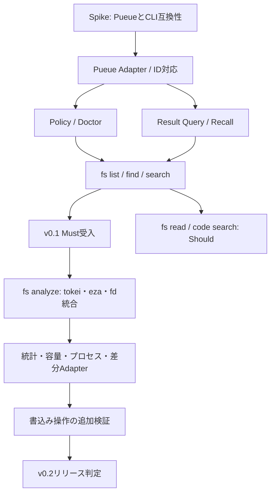

# v0.1〜v0.2 実装ロードマップ

> 出典: 2026-10-13時点の統合版 `REQUIREMENTS.md`。要件ID・受入条件IDは維持。

## 10. v0.1〜v0.2 コマンド実装計画

この章はリリース計画であり、`FUNCTIONAL_REQUIREMENTS.md` の機能要件および `VERIFICATION.md` の受入条件と併せて利用する。`v0.2`への候補は**必ず実装するという保証ではなく**、下記の受入条件を満たしたものだけを公開する。両バージョンを通じて、Pueueは非同期実行・ログ保持、axvernは制御・クエリ・薄いAdapterに徹する。

### 10.1 マイルストーンと完了ゲート

| 段階 | リリース目標 | 実装するもの | 完了条件 |
| --- | --- | --- | --- |
| M0 | v0.1着手前 | Pueue引数・ID・ログ・終了状態のSpike、CLI置換の互換性検証 | `VERIFICATION.md` のSpikeで挙げた阻害的な不確実性を解消し、使えない経路を明示 |
| M1 | v0.1 | `run` / `status` / `wait` / `history`、実行ID対応付け | 1回だけ安全に登録・状態照会でき、他人のPueueタスクと混同しない |
| M2 | v0.1 | `query` / `recall`、部分抽出、結果件数・サイズ制限 | コマンドを再実行せず部分抽出でき、ログ消失を区別できる |
| M3 | v0.1 | `policy check` / `doctor`、最小限の自動置換（opt-in） | Deny/Askが実行前に有効、未確認の置換は起こらない |
| M4 | v0.1 | `fs list` / `fs find` / `fs search` | eza/fd/rgが既存のPolicy・Pueue・Queryを経由する |
| M5 | v0.1候補 | `fs read` / `code search`（Should） | Spike・受入条件を通過した場合のみ追加。未完成でもv0.1 Must要件を妨げない |
| M6 | v0.2 | `fs analyze` / `code stats` / `system disk-usage` / `system processes` / `code diff` | `fs analyze`のツール統合と各ツールの非対話出力・結果抽出・失敗処理・依存不足を検証 |
| M7 | v0.2候補 | `text replace`（sd） | ファイル変更の副作用を明示し、Ask/Denyと変更内容の検証が通った場合のみ公開 |
| M8 | v0.2リリース | 回帰・互換性・セキュリティ試験、Docs更新 | v0.1の契約を維持し、全公開コマンドの受入テストが通る |

### 10.2 v0.1 コマンド別実装計画

| CLI | 委譲先 | 実装単位 | 最低限の受入条件 |
| --- | --- | --- | --- |
| `axvern run -- ...` | Pueue | 引数処理、ポリシー評価、タスク登録・ID記録 | 空白・Unicode・メタ文字を安全に処理し、登録が1回だけ |
| `axvern status <id>` | Pueue | ID解決、状態正規化 | queued/running/done/failed/unknownを区別 |
| `axvern wait <id>` | Pueue | ポーリング・タイムアウト | waitタイムアウトは子タスクを勝手に停止しない |
| `axvern history` | ローカルID対応情報＋Pueue | 管理対象のみ一覧 | 別ツールが登録したタスクを混ぜない |
| `axvern query <id>` | Pueueログ | match/errors/tail/行範囲、件数制限 | 元のタスクを再実行せず、行番号と不完全ログを明示 |
| `axvern recall <id>` | Pueueログ | 全量明示取得 | 生ログを利用可能な範囲で正確に返す。消失時は明示エラー |
| `axvern policy check -- ...` | axvern | Allow/Ask/Denyを副作用なく判定 | コマンドを登録・実行しない |
| `axvern doctor` | axvern＋依存CLI | デーモン・設定・依存コマンド診断 | Pass/Warning/Failと修復方法、JSON出力 |
| `axvern fs list [path]` | eza | パス・一覧フラグの明示マッピング | 色/ページャ無効、結果は実行IDから取得可 |
| `axvern fs find <pattern> [path]` | fd | パターン・hidden・ignoreを明示マッピング | fd固有のignore挙動を仕様通りに扱う |
| `axvern fs search <pattern> [path]` | rg | 検索パターン・hidden・ignoreを明示マッピング | 一致なしと実行エラーを識別し、抽出可能 |
| `axvern fs read <file>`（Should） | bat | 行範囲指定と非対話閲覧 | 指定範囲、行番号、ページャ制御を検証 |
| `axvern code search ...`（Should） | ast-grep | パターン・言語・パスの指定 | 構文エラーと一致なしを区別 |

**コマンドの公開規則**：内部コマンドをそのまま露出せず、用途と引数意味が一意に定義できる薄いAdapterを実装する。置換後も元コマンドと実コマンドの双方をPolicyに通す。自動置換はデフォルト無効のままとし、`ls`等の検証済み形式だけを許可する。`find`→`fd`、`grep`→`rg`、`cat`→`bat`の無条件置換はしない。

### 10.3 v0.2 コマンド別実装計画

| CLI案 | ツール | 用途・実装範囲 | 受入条件 | 優先度 |
| --- | --- | --- | --- | --- |
| `axvern fs analyze <path>` | tokei + eza + fd | 言語統計・制限付きツリー・構成ファイル発見を統合し、分析IDから再参照 | JSONスキーマ、親子実行ID、部分失敗、走査上限、リンク挙動をテスト | Must |
| `axvern code stats [path]` | tokei | 言語別ファイル数・コード行数・コメント数の取得 | 集計対象・除外規則を明示し、非対話で安定して解析できる | Should |
| `axvern system disk-usage [path]` | dust | 指定パス配下の容量上位項目を表示 | 単位・アクセス不可・シンボリックリンクの扱いを明示し、出力上限を設ける | Should |
| `axvern system processes [--match <text>]` | procs | プロセスのスナップショットと絞り込み | 一時点の情報であると明示し、権限不足や列形式の違いを扱う | Should |
| `axvern code diff [--staged]` | git + delta | Git差分の読みやすい表示（deltaは表示専用） | Gitの終了状態・差分意味を維持し、カラーなしで抽出可能 | Should |
| `axvern text replace <pattern> <replacement> <path>` | sd | **明示的な**ファイル変更操作 | 書込み前Policy判定、非対話Askの拒否、対象ファイル・変更件数の把握を必須とする | Could |

v0.2でも`sed`の自動置換や`rm`の代替による暗黙の削除は実装しない。`text replace`は変更を伴うため、単なる読み取り操作として扱わない。`zoxide`（シェル状態）、`bottom`（TUI）、`hyperfine`（反復実行）、`xh`（通信）、`rip`（削除）はv0.2の範囲外とする。

### 10.4 共通実装タスクと依存関係

実装時は、①コマンドごとに引数マッピングを定義、②ポリシー判定、③Pueueへ一度だけ投入、④状態/ログを抽出、⑤機械可読な応答をテスト、の共通チェックを使う。**アダプターのために独自の実行デーモンや新しいタスクランナーを作らない**。

### 10.5 バージョン別受入ゲート

- **v0.1 Must**：AC-01〜AC-22のうちMust要件に対応するケースがすべて通過。AC-23/24（Should）は未実装を許容。既存CLIへの自動置換はopt-inのみ。
- **v0.1 推奨**：`fs read`・`code search`を実装した場合はAC-23/24を必ず通す。
- **v0.2**：`fs analyze`（Must）および`code stats`、`system disk-usage`、`system processes`、`code diff`の各公開コマンドに、正常系・一致/対象なし・依存ツール不足・権限エラー・大量出力・Policy拒否のテストを追加する。書込み系`text replace`は要件を満たせないなら延期する。
- **共通ゲート**：Pueueへ二重登録しない、終了理由を正しく表示する、ログ削除後に存在するかのように扱わない、機密情報を不用意に表示しない、macOS/Linuxで非対話実行を検証する。

### 10.6 `fs analyze` 実装タスク（v0.2）

1. `tokei --output json <path>` の対応バージョン・失敗時挙動・無対象時のJSONを検証し、言語集計を型付きデータへ変換する。
2. `eza --tree --level <N> <path>` を色なし・非対話で実行し、表示最大行数を制御する。
3. `fd`による設定ファイル探索対象と除外条件を固定し、パス情報を正規化する。
4. `fs analyze`の親分析IDと3つのPueue子タスクIDを関連付ける。各タスクに同一パス・時刻情報・Policy結果を記録する。
5. 各部分結果を統合してテキスト概要とJSONを生成する。失敗した子処理は隠さずwarningsに含める。
6. 最小fixture（Rustのみ、TSのみ、混在、空、シンボリックリンク、アクセス拒否）で受入テストを行う。

#### 追加受入条件

| ID | シナリオ | 期待結果 |
| --- | --- | --- |
| AC-27 | Rust / TypeScript混在パス | 言語別統計・ツリー・主要設定ファイルを1結果に集約する |
| AC-28 | `--max-depth 2` | ツリーが2階層に限定され、統計の集計範囲と混同されない |
| AC-29 | 設定ファイルが存在しない | `manifests`が空であり、架空の技術スタックを推定しない |
| AC-30 | 子コマンドの一部が失敗 | 成功した部分は表示し、失敗箇所を警告と終了状態で区別する |
| AC-31 | 同じ分析IDで再取得 | 再走査せずに保存済みの結果を取得できる（Pueue側にログが残っている範囲） |
| AC-32 | シンボリックリンク・大量ツリー | リンクを無限追跡せず、件数・深さ制限を守る |

## 11. 将来拡張（v0.2対象外）

- Coding Agent Hooks/Adapters（Claude Code、Codexなど）
- 任意Docker/Dev Container Runtime
- OpenTelemetryによる実行時間、ログ抽出率、失敗率の計測
- 保存ログの高度なインデックス、意味検索
- axvern独自の明示的なログアーカイブ機能（Pueueログの保持期間を超える保存）
- タスクキャンセル、キュー優先順位、グループ操作などの高度な管理UI
- v0.2以降のツール追加・高度な集約（`bat`・`ast-grep`はv0.1 Should、`tokei`・`dust`・`procs`・`delta`はv0.2で評価）
- 任意のシェルコマンドの完全な解析・自動書換え

